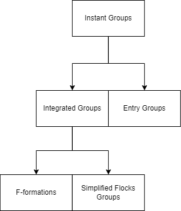

# Groups

## Summary
Project containing components for groups detections, the following diagram explains the hierarchy of components:  

## Files

### Detectors
* [Entry Groups Detector](src/EntryGroupsDetector.cs)
* [Entry Groups Detector Configuration](src/EntryGroupsDetectorConfiguration.cs)
* [Flock Group Intersection](src/FlockGroupIntersection.cs)
* [Instant Groups Detector](src/InstantGroupsDetector.cs)
* [Instant Groups Detector Configuration](src/InstantGroupsDetectorConfiguration.cs)
* [Integrated Groups Detector](src/IntegratedGroupsDetector.cs)
* [Integrated Groups Detector Configuration](src/IntegratedGroupsDetectorConfiguration.cs)
* [Simplified Flock Group](src/SimplifiedFlockGroup.cs)
* [Simplified Flock Groups Detector](src/SimplifiedFlockGroupsDetector.cs)
* [Simplified Flock Groups Detector Configuration](src/SimplifiedFlockGroupsDetectorConfiguration.cs)

### Graph Classes
* [Edge Width Mode](src/GraphClass/EdgeWidthMode.cs) - Enumeration for edge width display modes
* [Individual Pair Characteristics](src/GraphClass/IndividualPairCharacteristics.cs) - State of a group at one instant, for a sociogram: a node per participant, an edge per pair and the values of the group, for any number of participants. The metrics are kept by name; one that is not computed is absent
* [Graph Metric Names](src/GraphClass/GraphMetricNames.cs) - Names of the metrics, which are those of the collaboration indices
* [Group Instant](src/GraphClass/GroupInstant.cs) - What a group is doing at one instant: where each participant is and which way it faces, who speaks, who looks at whom or at what, which pairs stand in a formation, what each one holds, and what was just detected. Nothing in it is a mean; what is not known is left out
* [Graph Metrics](src/GraphClass/GraphMetrics.cs) - Reading of the metrics and order of the identifiers
* [Node Size Mode](src/GraphClass/NodeSizeMode.cs) - Enumeration for node size display modes
* [Person Edge](src/GraphClass/PersonEdge.cs) - Edge representation between persons: metrics of the pair, and those that have a direction once per direction
* [Person Group](src/GraphClass/PersonGroup.cs) - Group representation: who does the most of something, and the scores of the collaboration model
* [Person Node](src/GraphClass/PersonNode.cs) - Node representation for persons

The graph is built from the collaboration indices by `SocialGraph` of the CollaborationIndices component
(`indices.ToSocialGraph()`), to be drawn as a sociogram.
The properties written before the collaboration indices (`SpeakingTime`, `Proximity`, `GazeOnPeers12`,
`Collaboration_score`...) still read and write the metrics; read, a metric that is absent gives 0, and `Has(name)`
tells whether it is there. An edge holds the distance of its pair at the instant (`Distance`) and its mean over
the window of the other metrics (`MeanDistance`). A node may hold the place of its participant in the room,
seen from above (`PositionX`, `PositionY`, and their means over the window).

`GroupInstant` is the counterpart of that graph for the instant: it is built by `InstantStateComponent` of the
CollaborationIndices component, to be drawn as well.

### Helpers
* [Helpers](src/Helpers/Helpers.cs) contains methods for ID generation and group simplifications.

## Current issues

## Future works
